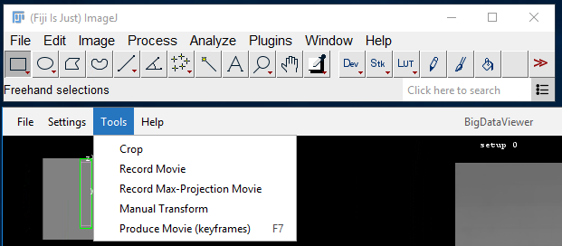
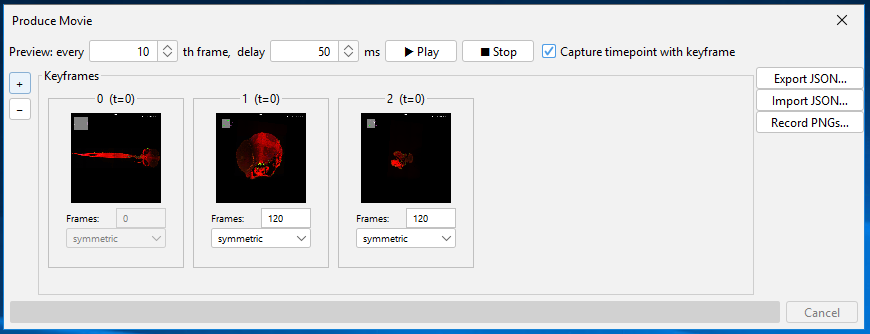

# BigDataViewer Movie Producer (Fiji plugin)

Keyframe-based movie making for BigDataViewer, packaged as a normal Fiji
plugin. Extracted from the fork
[PreibischLab/bigdataviewer-core-movie](https://github.com/PreibischLab/bigdataviewer-core-movie)
(original author Marwan Zouinkhi; easing curves from Stephan Saalfeld's
`hotknife.VNCMovie`). It no longer replaces Fiji's BigDataViewer — it adds
one small jar alongside it.

## What you get

* **F7** or **Tools › Produce Movie (keyframes)** in every BDV window
  (including windows opened by BigStitcher, Multiview Reconstruction, scripts).
  This is wired up automatically when a BDV window is created (the shortcut
  is also listed under BDV's Preferences › Keymap).
* Fallback command: **Plugins › BigDataViewer › Movie Producer (keyframes)**,
  which attaches to the most recently active BDV window.
* Add keyframes with **+**, set per-transition frame count and easing
  (symmetric / slow start / slow end / soft …), preview in the viewer,
  export / import keyframes as JSON (old JSON files from the fork still load),
  and render a PNG sequence at any resolution with optional scale bar and box
  overlay.



*The movie producer in BDV's Tools menu (shortcut F7).*



*The Produce Movie dialog: preview controls on top, the keyframe strip with
per-transition frame count and easing, and export / import / record on the
right.*

### Changes vs. the original fork

* Builds against current `bigdataviewer-core` (pom-scijava 44) instead of a
  2022 fork of it.
* Preview Stop no longer uses `Thread.stop/suspend/resume` (they throw on the
  Java 21 that current Fiji ships).
* Recording and import run on background threads, so the UI does not freeze;
  recording shows progress and can be cancelled.
* Recording renders from a snapshot of the viewer state, so the live window is
  not moved/resized during export.
* Keyframes remember the canvas size they were captured at, so resizing the
  BDV window or recording at a different resolution keeps the same framing.
* Optional: keyframes capture the current **timepoint**, and the timepoint is
  interpolated between keyframes (for time-lapse data). Untick
  "Capture timepoint with keyframe" for a purely spatial fly-through.

## Build

Requirements: a JDK (17 or 21; e.g. [Eclipse Temurin](https://adoptium.net))
and [Maven](https://maven.apache.org/download.cgi). Works the same on Windows,
macOS and Linux.

```
mvn package
```

The plugin is `target/bigdataviewer-movie-producer-0.1.0-SNAPSHOT.jar`.

No local toolchain? Fork this repository on GitHub: the included
workflow (`.github/workflows/build.yml`) builds it and attaches the jar as a
downloadable artifact under the **Actions** tab.

Or simply download the compiled jar from the Releases.

## Install

Copy the jar into `Fiji.app/plugins/` (or `Fiji.app/jars/`) and restart Fiji.

## Making a movie from the PNGs

In Fiji: *File › Import › Image Sequence…* on the output folder, then
*File › Save As › AVI…*. Or with ffmpeg:

```
ffmpeg -framerate 30 -i img-%05d.png -c:v libx264 -pix_fmt yuv420p -crf 18 movie.mp4
```

## License

GPL-2.0-or-later (the easing code derives from GPL-2 code; the rest of the
original fork is BSD-2 from bigdataviewer-core).
